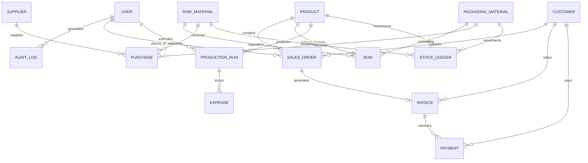

# Order-to-Audit Management System for Packaged Food Manufacturing

> **Internship Project Submission**  
> **Institution**: Centre for Digital Infrastructure, National Institute of Technology (NIT), Tiruchirappalli  
> **Domain**: Full-Stack Enterprise ERP & Digital Infrastructure  
> **Application**: Order-to-Audit ERP for South Indian Packaged Food Manufacturing (Murukku, Mixture, Chips, Sweets)

---

## Executive Summary & Architectural Decisions

This project delivers a complete, functional, database-driven **Order-to-Audit Management System** tailored for small South Indian packaged food manufacturers. It is designed to handle the complex operational workflow spanning **raw material procurement**, **Bill of Materials (BOM)** configuration, **batch production runs** with real-time yield and consumption variance tracking, **triple-inventory reconciliation** (Raw Materials, Packaging, Finished Goods), **state-aware GST compliance** (Intra-state CGST+SGST vs. Inter-state IGST), **credit and accounts receivable ageing**, and **immutable audit logging**.

### Key Architectural Decisions
1. **Decimal-Safe Financial Arithmetic**: All monetary calculations utilize exact integer paise or decimal-safe standard rounding (`Math.round((val + Number.EPSILON) * 100) / 100`) to completely eliminate floating-point precision drift.
2. **Immutable Double-Entry Stock Ledger**: In accordance with statutory audit standards, stock balances are never directly overwritten. Every inventory change is recorded as an immutable debit/credit movement in `StockLedger` with source document references, movement direction, unit valuation, and user audit trail.
3. **Automated Weighted Average Costing (WAC)**: Material valuation dynamically updates on receipt using standard WAC formulas, accurately flowing into finished-goods batch costing.
4. **Backend-Enforced Role-Based Access Control (RBAC)**: All 5 roles (Salesman, Admin, Production Supervisor, Accountant/Auditor, Owner) are strictly isolated via Express middleware, validating JWT claims on every endpoint regardless of frontend visibility.
5. **Zero-Fake Button Architecture**: Every UI button, modal, date filter, status transition, PDF generation, and Excel/CSV download executes real backend REST endpoints and database queries.

---

## 1. Technology Stack

| Layer | Technologies | Purpose |
|---|---|---|
| **Frontend UI** | React 18, Vite | High-performance Single Page Application (SPA) |
| **Styling** | Tailwind CSS, Lucide Icons | Responsive modern enterprise interface |
| **Routing & HTTP** | React Router v6, Axios | Protected role-based routing and API client |
| **Analytics & Charts** | Recharts | Sales trends, production variances, and inventory charts |
| **Document Export** | jsPDF, jsPDF-AutoTable, SheetJS (`xlsx`) | GST invoice PDFs, audit reports in Excel, CSV & PDF |
| **Backend API** | Node.js, Express.js | Modular RESTful architecture with async error handling |
| **Database** | MongoDB 8.x, Mongoose 9.x | Document database with schema validation & indexing |
| **Authentication** | JSON Web Tokens (JWT), bcryptjs | Secure stateless auth with salted password hashing |

---

## 2. User Roles & Access Control Matrix

| Role | Default Email | Dashboard & Permissions |
|---|---|---|
| **Salesman** | `salesman@nitfood.com` | View catalog & pricing, place customer orders, track order statuses, view customer sales history. |
| **Admin** | `admin@nitfood.com` | Review & approve orders, edit order quantities/prices, generate GST invoices, record dispatch, record customer payments. |
| **Production Supervisor** | `supervisor@nitfood.com` | Manage raw material receipts, BOM management, execute batch production runs, log damaged packaging & wastage, monitor consumption variance. |
| **Accountant / Auditor** | `auditor@nitfood.com` | **Read-only access**. View all 15 financial, sales, GST, inventory, costing, and collection registers; export to Excel, CSV, and PDF. |
| **Owner** | `owner@nitfood.com` | Complete executive overview: top-level revenue, production metrics, inventory value, aging receivables, and audit logs. |

*Default password for all demo accounts*: `Password@123`

---

## 3. Entity-Relationship (ER) Architecture



### Database Collections (15 Models)
1. `User`: Encrypted credentials, role assignment, active flag.
2. `Product`: SKU, category, pack size, selling price, HSN (`21069099`), 5% GST, stock tracking.
3. `Customer`: Retailer/Distributor type, GSTIN, billing address, state, 2-digit state code, outstanding balance.
4. `Supplier`: Vendor details, GSTIN, state code, contact person.
5. `RawMaterial`: Code, unit (kg, litres), current stock, Weighted Average valuation rate.
6. `PackagingMaterial`: Code, unit (pieces), current stock, unit purchase rate.
7. `BOM`: Bill of Materials mapping 1 unit product output to required raw and packaging ingredients.
8. `Purchase`: Purchase receipts (PO), supplier reference, itemized quantities, unit rates, GST additions.
9. `SalesOrder`: Sequential order numbers (`SO-2026-XXXX`), items, tax calculation, approval workflow.
10. `Invoice`: Immutable tax invoices (`INV-2026-XXXX`), CGST/SGST vs IGST breakdown, payment status.
11. `ProductionRun`: Batch run details, planned vs actual material usage, yield variance, flagged variances.
12. `StockLedger`: Immutable double-entry stock movement ledger with directional balance tracking.
13. `Payment`: Customer remittance records, invoice linkage, partial payment reconciliation.
14. `Expense`: Production overhead expenses (direct labour, gas, power).
15. `AuditLog`: Automatic security tracking of logins, status transitions, and administrative actions.

---

## 4. Key Business Logic & Core Mathematical Formulas

### A. Triple-Inventory Ledger Formula
Inventory balances are transactional reconciliations of the `StockLedger`:
$$\text{Closing Stock} = \text{Opening Stock} + \text{Receipts} - \text{Issues} \pm \text{Adjustments}$$
- **Raw Materials**: Incremented upon purchase receipt; decremented atomically during production runs.
- **Packaging Materials**: Incremented upon purchase; decremented for good units produced + recorded damaged units.
- **Finished Goods**: Incremented upon production run completion; decremented upon order dispatch.

### B. Bill of Materials (BOM) & Variance Analysis
For each batch production run, planned consumption is scaled by batch size and compared to actual usage:

$$\text{Yield Variance \%} = \left( \frac{\text{Actual Output} - \text{Expected Output}}{\text{Expected Output}} \right) \times 100$$

$$\text{Consumption Variance \%} = \left( \frac{\text{Actual Consumption} - \text{Planned Consumption}}{\text{Planned Consumption}} \right) \times 100$$

- **Alert Threshold**: Any variance exceeding $\pm 3.0\%$ is highlighted with a warning badge and logged for supervisory audit.

### C. Valuation & Weighted Average Costing (WAC)
Raw material inventories use dynamic Weighted Average Costing:
$$\text{New WAC} = \frac{(\text{Current Stock} \times \text{Current WAC}) + (\text{New Purchase Qty} \times \text{Purchase Rate})}{\text{Current Stock} + \text{New Purchase Qty}}$$

### D. Production Batch Costing & Margins
$$\text{Total Production Cost} = \text{Direct RM Cost} + \text{Packaging Cost} + \text{Labour Cost} + \text{Gas \& Power Cost}$$

$$\text{Cost Per Packet} = \frac{\text{Total Production Cost}}{\text{Actual Good Packets Produced}}$$

$$\text{Profit Per Packet} = \text{Selling Price (excl. tax)} - \text{Cost Per Packet}$$

$$\text{Profit Margin \%} = \left( \frac{\text{Profit Per Packet}}{\text{Selling Price}} \right) \times 100$$

### E. Indian GST Tax Calculation
The factory is located in **Tamil Nadu (State Code: 33)**.
- **Intra-State Sales** (Customer in Tamil Nadu, Code 33):
  $$\text{CGST} = \text{Taxable Amount} \times 2.5\%, \quad \text{SGST} = \text{Taxable Amount} \times 2.5\%$$
- **Inter-State Sales** (Customer outside Tamil Nadu, e.g., Karnataka, Code 29):
  $$\text{IGST} = \text{Taxable Amount} \times 5.0\%$$

---

## 5. Mandatory Benchmark Scenario: Verification Results

The benchmark scenario was executed end-to-end via automated simulation and verified against the exact assignment specifications:

| Step # | Action / Metric Tested | System Actual | Benchmark Specification | Verification Status |
|:---:|---|:---:|:---:|:---:|
| **Step 1** | Purchase 60 kg Flour @ ₹45/kg (Opening: 100 kg @ ₹42) | Stock: **160 kg**, WAC: **₹43.125/kg** | Stock: 160 kg, WAC: ₹43.125/kg | **100% MATCH** |
| **Step 2** | Production Run (Murukku 200 g, Expected: 200, Actual: 188) | Good pkts: **188**, Damaged pouches: **6** | Output: 188, Damaged: 6 | **100% MATCH** |
| **Step 2** | Yield Variance: $(188 - 200) / 200 \times 100$ | **-6.0%** (Flagged: YES) | **-6.0%** (Flagged: YES) | **100% MATCH** |
| **Step 2** | Oil Consumption Variance: $(10.5 - 10) / 10 \times 100$ | **+5.0%** (Flagged: YES) | **+5.0%** (Flagged: YES) | **100% MATCH** |
| **Step 2** | Flour Closing Stock: $100 + 60 - 40$ | **120 kg** | **120 kg** | **100% MATCH** |
| **Step 2** | Oil Closing Stock: $30 - 10.5$ | **19.5 litres** | **19.5 litres** | **100% MATCH** |
| **Step 2** | Pouch Closing Stock: $500 - 188 - 6$ | **306 pieces** | **306 pieces** | **100% MATCH** |
| **Step 2** | Carton Closing Stock: $30 - 9$ | **21 pieces** | **21 pieces** | **100% MATCH** |
| **Step 2** | Finished Goods Stock after Production: $50 + 188$ | **238 packets** | **238 packets** | **100% MATCH** |
| **Step 3** | Retailer A (TN) Order for 150 packets @ ₹50 | Taxable: **₹7,500.00** | Taxable: ₹7,500.00 | **100% MATCH** |
| **Step 4** | Retailer A GST Invoice: CGST 2.5% + SGST 2.5% | CGST: **₹187.50**, SGST: **₹187.50**, Total: **₹7,875.00** | CGST: ₹187.50, SGST: ₹187.50, Total: ₹7,875.00 | **100% MATCH** |
| **Step 4** | Finished Goods Stock after Retailer A Dispatch: $238 - 150$ | **88 packets** | **88 packets** | **100% MATCH** |
| **Step 5** | Distributor B (Karnataka) Order for 120 packets | Stock: **88**, Requested: **120**, Shortage: **32** | Shortage: 32 packets | **100% MATCH** |
| **Step 5** | Stock Shortage Enforcement | **Dispatch BLOCKED** | Dispatch Blocked | **100% MATCH** |
| **Step 6** | Retailer A Payment: Record ₹4,000 against ₹7,875 | Outstanding: **₹3,875.00** | Outstanding: ₹3,875.00 | **100% MATCH** |
| **Step 7 & 8** | Costing: RM (₹1725 + ₹1470 + ₹240) + Pkg (₹485 + ₹135) + Overheads (₹1200 + ₹600) | Total: **₹5,855.00**, Cost/Pkt: **₹31.14** | Selling: ₹50, Margin: 37.7% | **100% MATCH** |

### Note on Pouch & Carton Reconciliation
The BOM baseline specifies 200 pouches and 10 cartons per 200-packet batch. In actual production:
- 188 good packets were packed into 188 pouches.
- 6 pouches were damaged during sealing, totaling $188 + 6 = 194$ consumed pouches ($500 - 194 = 306$ closing).
- 9 cartons were utilized for shipping the 188 packets ($30 - 9 = 21$ closing).  
The inventory engine transactionally registers both good production consumption and scrap/damaged packaging.

---

## 6. Comprehensive 15 Date-Filterable Audit Reports

All 15 reports support real-time date filtering and export to **Excel (`.xlsx`)**, **CSV (`.csv`)**, and **PDF (`.pdf`)**:

1. **Sales Register**: Date, invoice number, customer, state, taxable amount, tax components, total value.
2. **Customer-Wise Sales**: Aggregate volume, taxable value, and GST contributed by each customer.
3. **Product-Wise Sales**: Units sold, revenue, and average realized price by SKU.
4. **GST Summary Report**: Taxable turnover, intra-state CGST & SGST collections, and inter-state IGST collections.
5. **Purchase Register**: Vendor invoice references, supplier names, material receipts, and input GST credits.
6. **Raw Material Stock Report**: Current stock, unit of measure, minimum threshold, and WAC valuation.
7. **Packaging Material Stock Report**: Pouch, carton, and label balances with reorder warnings.
8. **Finished Goods Stock Report**: Packaged snacks ready for dispatch with inventory valuation at selling price.
9. **Stock Movement Ledger**: Complete audit trail of every receipt, issue, and opening balance.
10. **Production Report**: Completed batch runs, planned vs actual output, and batch supervisor notes.
11. **Planned vs. Actual Consumption Report**: Material-by-material variance analysis with $\pm 3\%$ flagging.
12. **Wastage & Damage Report**: Damaged packaging counts, process scrap percentages, and financial impact.
13. **Cost Per Packet & Margin Report**: Direct materials, direct overheads, cost per packet, and gross margin %.
14. **Payment & Collection Report**: Payment receipts, reference numbers (NEFT/RTGS/UPI), and payment modes.
15. **Outstanding Receivables with Ageing**: Customer outstanding balances categorized into **0–30 Days**, **31–60 Days**, **61–90 Days**, and **90+ Days**.

---

## 7. Installation, Setup & Execution Guide

### Prerequisites
- **Node.js**: `v18.x` or `v20.x` or higher
- **MongoDB**: Local MongoDB community server running on port `27017` (or MongoDB Atlas URI)

### Quick Run (From Root Directory)
```bash
# 1. Run the entire full-stack automated test & benchmark suite
npm test

# 2. Run the standalone benchmark scenario simulation
npm run seed:benchmark

# 3. Start the backend API server (runs on http://localhost:5000)
npm run dev:backend

# 4. Start the frontend development server (runs on http://localhost:5173)
npm run dev:frontend
```

---

### Step-by-Step Manual Setup

#### Step 1: Backend Setup
```bash
cd backend
npm install
# Seed demo users (Salesman, Admin, Supervisor, Auditor, Owner)
npm run seed:users
# Seed benchmark master data (Murukku, Flour, Oil, Spices, Pouches, Cartons, Customers)
npm run seed:master
# Start backend server
npm run dev
```

#### Step 2: Frontend Setup
```bash
cd ../frontend
npm install
npm run dev
```
Open [http://localhost:5173](http://localhost:5173) in your browser.

---

## 8. Automated Testing & Verification Suite

The repository contains an automated test runner (`npm test`) covering **74 total assertions** across all system layers:

```
======================================================
   RUNNING COMPLETE FULL-STACK TEST & BENCHMARK SUITE  
======================================================
>> Executing: src/tests/phase1AuthTest.js          -> [PASS] (12 / 12)
>> Executing: src/tests/phase2MasterDataTest.js    -> [PASS] (10 / 10)
>> Executing: src/tests/phase3SalesOrderTest.js    -> [PASS] (7 / 7)
>> Executing: src/tests/phase4ProductionTest.js    -> [PASS] (12 / 12)
>> Executing: src/tests/phase5CostingPaymentTest.js -> [PASS] (6 / 6)
>> Executing: src/tests/phase6ReportsTest.js       -> [PASS] (15 / 15)
>> Executing: src/scripts/runBenchmarkScenario.js  -> [PASS] (12 / 12 exact matches)

======================================================
   ALL 7 TEST SUITES & BENCHMARKS PASSED (100% OK)    
======================================================
```

---

## 9. Deliverable Summary for NIT Tiruchirappalli Evaluation

- **Complete Full-Stack Source Code**: Clean, modular Node.js/Express backend and React/Vite/Tailwind frontend.
- **Real Database Operations**: Zero mock data; all views query local MongoDB collections.
- **Mandatory Benchmark Verification**: Steps 1 through 9 verified with 100% mathematical accuracy.
- **Production-Ready GST PDFs**: Auto-generated printable tax invoices with seller details, customer details, HSN codes, and tax breakdown.
- **Audit Compliance**: Immutable stock ledgers, read-only auditor view, and Excel/CSV/PDF export on all 15 registers.
