# ENTITY-RELATIONSHIP (ER) SPECIFICATION & DATA MODEL
## NIT Tiruchirappalli — CDI Food Manufacturing Order-to-Audit ERP

**Document Version**: 1.0  
**Target Organization**: Centre for Digital Infrastructure (CDI), NIT Tiruchirappalli  
**Domain**: Packaged Food Manufacturing (Murukku, Mixture, Chips, Sweets)  
**Database**: MongoDB 8.x with Mongoose 9.x ODM  
**Evaluation Level**: Senior Software Engineer / Internship Submission

---

## 1. DATA MODEL ARCHITECTURAL OVERVIEW

In this enterprise Order-to-Audit Management System, the data layer is architected using **MongoDB document collections** accessed via **Mongoose schemas**. The system balances MongoDB's document-oriented paradigms (such as embedding line items inside transactional documents) with formal cross-document references (`ObjectId` refs) to guarantee data integrity, double-entry auditability, and state-aware financial calculations.

### Core Modeling Principles
1. **Embedding for Immutability & Atomicity**: Order line items, invoice line items, and production consumption items are embedded within their parent transactional documents (`SalesOrder.items`, `Invoice.items`, `ProductionRun.rawMaterials`, `ProductionRun.packagingMaterials`, `Purchase.items`). This ensures that if product prices or master specifications change in the future, past transaction records remain historically immutable.
2. **References for Relational Integrity**: Master items (`Product`, `Customer`, `Supplier`, `RawMaterial`, `PackagingMaterial`, `User`, `BOM`) are maintained in discrete collections and referenced by `ObjectId`.
3. **Polymorphic Double-Entry Stock Ledger**: The `StockLedger` collection uses a polymorphic reference pattern (`item` with `refPath: 'itemType'`), pointing dynamically to `RawMaterial`, `PackagingMaterial`, or `Product`.
4. **Lifecycle State vs. Separate Collections**: Operational processes like **Dispatch** do not require redundant standalone collections; instead, Dispatch is modeled as an atomic state transition on `SalesOrder` (`status: 'Dispatched'`, `dispatchedAt: Date`) coupled with an immutable outflow entry in `StockLedger` and a trace in `AuditLog`.

---

## 2. COMPLETE MERMAID ENTITY-RELATIONSHIP DIAGRAM

The following diagram captures all 15 Mongoose models, their primary keys (`_id`), foreign key references, and relationship cardinalities.

```mermaid
erDiagram
    USER ||--o{ SALES_ORDER : "places (Salesman) / approves (Admin)"
    USER ||--o{ PURCHASE : "receives"
    USER ||--o{ PRODUCTION_RUN : "supervises"
    USER ||--o{ PAYMENT : "records"
    USER ||--o{ EXPENSE : "records"
    USER ||--o{ STOCK_LEDGER : "authorizes movement"
    USER ||--o{ AUDIT_LOG : "triggers"

    CUSTOMER ||--o{ SALES_ORDER : "places"
    CUSTOMER ||--o{ INVOICE : "billed to"
    CUSTOMER ||--o{ PAYMENT : "remits"

    SUPPLIER ||--o{ PURCHASE : "supplies materials"

    PRODUCT ||--o{ BOM : "formulated by"
    PRODUCT ||--o{ PRODUCTION_RUN : "yields finished goods"
    PRODUCT ||--o{ SALES_ORDER : "ordered in items"
    PRODUCT ||--o{ INVOICE : "billed in items"
    PRODUCT ||--o{ STOCK_LEDGER : "tracked in ledger"

    RAW_MATERIAL ||--o{ BOM : "listed as ingredient"
    RAW_MATERIAL ||--o{ PURCHASE : "received in items"
    RAW_MATERIAL ||--o{ PRODUCTION_RUN : "consumed in batch"
    RAW_MATERIAL ||--o{ STOCK_LEDGER : "tracked in ledger"

    PACKAGING_MATERIAL ||--o{ BOM : "listed as packaging"
    PACKAGING_MATERIAL ||--o{ PURCHASE : "received in items"
    PACKAGING_MATERIAL ||--o{ PRODUCTION_RUN : "used / scrapped in batch"
    PACKAGING_MATERIAL ||--o{ STOCK_LEDGER : "tracked in ledger"

    BOM ||--o{ PRODUCTION_RUN : "executes batch run"

    SALES_ORDER ||--o| INVOICE : "generates tax invoice"
    SALES_ORDER ||--o{ STOCK_LEDGER : "triggers sales dispatch"

    INVOICE ||--o{ PAYMENT : "reconciled by"

    PRODUCTION_RUN ||--o{ EXPENSE : "incurs direct expenses"
    PRODUCTION_RUN ||--o{ STOCK_LEDGER : "issues RM and yields FG"

    USER {
        ObjectId _id PK
        string name
        string email UK
        string password
        string role "salesman|admin|production_supervisor|accountant_auditor|owner"
        string phone
        boolean isActive
        date createdAt
    }

    CUSTOMER {
        ObjectId _id PK
        string name
        string customerType "Retailer|Distributor"
        string gstin
        string phone
        string address
        string state
        string stateCode "33 (TN)|29 (KA)"
        number creditLimit
        number outstandingBalance
        boolean isActive
    }

    SUPPLIER {
        ObjectId _id PK
        string name
        string contactPerson
        string gstin
        string phone
        string address
        string state
        string stateCode
        array suppliedMaterialTypes
        boolean isActive
    }

    PRODUCT {
        ObjectId _id PK
        string name
        string sku UK
        string category "Murukku|Mixture|Chips|Sweets"
        number packSize
        string packUnit "g"
        number sellingPrice
        number gstPercentage "5%"
        string hsnCode "21069099"
        string unit "packets"
        number currentStock
        number minStockLevel
        boolean isActive
    }

    RAW_MATERIAL {
        ObjectId _id PK
        string name
        string code UK
        string category
        string unit "kg|litres|grams|pieces|bags"
        number currentStock
        number reorderLevel
        number valuationRate "WAC rate"
        number totalValue
        string hsnCode
        boolean isActive
    }

    PACKAGING_MATERIAL {
        ObjectId _id PK
        string name
        string code UK
        string unit "pieces"
        number currentStock
        number reorderLevel
        number valuationRate
        number totalValue
        string hsnCode
        boolean isActive
    }

    BOM {
        ObjectId _id PK
        ObjectId product FK
        string version "v1.0"
        number expectedOutput "e.g. 200"
        string outputUnit "packets"
        array rawMaterials "embedded subdocs"
        array packagingMaterials "embedded subdocs"
        string notes
        boolean isActive
    }

    PURCHASE {
        ObjectId _id PK
        string purchaseNumber UK
        ObjectId supplier FK
        string invoiceNumber
        date purchaseDate
        array items "embedded subdocs"
        number subtotal
        number totalTax
        number grandTotal
        string status "Pending|Received|Cancelled"
        string paymentStatus "Unpaid|Paid"
        ObjectId receivedBy FK
    }

    PRODUCTION_RUN {
        ObjectId _id PK
        string runNumber UK
        ObjectId product FK
        ObjectId bom FK
        number batchMultiplier
        number expectedOutput
        number actualOutput
        number yieldVarianceQuantity
        number yieldVariancePercentage
        boolean isYieldFlagged
        array rawMaterials "embedded consumption"
        array packagingMaterials "embedded consumption"
        number labourCost
        number gasAndElectricityCost
        number totalRawMaterialCost
        number totalPackagingCost
        number totalProductionCost
        number costPerPacket
        number sellingPricePerPacket
        number profitPerPacket
        number profitMarginPercentage
        string status "Completed|Draft|Cancelled"
        ObjectId supervisor FK
        date productionDate
    }

    SALES_ORDER {
        ObjectId _id PK
        string orderNumber UK
        ObjectId customer FK
        ObjectId salesman FK
        array items "embedded subdocs"
        number subtotal
        number totalTax
        number grandTotal
        boolean isInterState
        string status "Submitted|Approved|Rejected|Invoiced|Dispatched"
        date orderDate
        ObjectId approvedBy FK
        date dispatchedAt
        ObjectId invoice FK
    }

    INVOICE {
        ObjectId _id PK
        string invoiceNumber UK
        ObjectId order FK
        ObjectId customer FK
        string customerName
        string customerState
        string customerStateCode
        boolean isInterState
        date invoiceDate
        array items "embedded subdocs"
        number taxableAmount
        number cgstTotal
        number sgstTotal
        number igstTotal
        number totalTax
        number grandTotal
        number amountPaid
        number balanceDue
        string paymentStatus "Unpaid|Partially Paid|Paid"
        string status "Active|Cancelled"
        ObjectId generatedBy FK
    }

    PAYMENT {
        ObjectId _id PK
        string paymentNumber UK
        ObjectId customer FK
        ObjectId invoice FK
        date paymentDate
        number amount
        string paymentMode "CASH|NEFT|RTGS|UPI|CHEQUE|BANK_TRANSFER"
        string referenceNumber
        ObjectId recordedBy FK
    }

    EXPENSE {
        ObjectId _id PK
        string expenseNumber UK
        string category "LABOUR|GAS_POWER|MAINTENANCE|TRANSPORT|OTHER"
        number amount
        string description
        ObjectId productionRun FK
        date expenseDate
        ObjectId recordedBy FK
    }

    STOCK_LEDGER {
        ObjectId _id PK
        string itemType "RawMaterial|PackagingMaterial|Product"
        ObjectId item FK "polymorphic refPath"
        string itemName
        string itemCategory "raw_material|packaging_material|finished_goods"
        string movementType "OPENING_BALANCE|PURCHASE_RECEIPT|PRODUCTION_ISSUE|PRODUCTION_YIELD|SALES_DISPATCH|DAMAGE_SCRAP|STOCK_ADJUSTMENT"
        number direction "+1 Inflow | -1 Outflow"
        number quantity
        string unit
        number unitRate
        number totalValue
        number balanceBefore
        number balanceAfter
        string sourceDocumentType "InitialSetup|Purchase|ProductionRun|SalesOrder|Invoice|ManualAdjustment"
        ObjectId sourceDocumentId FK
        string sourceDocumentNumber
        date movementDate
        ObjectId user FK
    }

    AUDIT_LOG {
        ObjectId _id PK
        string action
        string entity "User|Product|Customer|Supplier|RawMaterial|PackagingMaterial|BOM|Purchase|SalesOrder|Invoice|ProductionRun|StockLedger|Payment|Expense|System"
        ObjectId entityId
        ObjectId performedBy FK
        string userName
        mixed details
        string ipAddress
        date createdAt
    }
```

---

## 3. ENTITY RELATIONSHIP CARDINALITY & MAPPING TABLE

| Source Entity | Relationship | Target Entity | Cardinality | Implementation in Mongoose |
| :--- | :--- | :--- | :---: | :--- |
| **User** | places / approves | **SalesOrder** | $1 : N$ | `salesman`, `approvedBy`, `rejectedBy` store `ObjectId` referencing `User`. |
| **User** | supervises | **ProductionRun** | $1 : N$ | `supervisor` stores `ObjectId` referencing `User`. |
| **User** | receives | **Purchase** | $1 : N$ | `receivedBy` stores `ObjectId` referencing `User`. |
| **User** | records | **Payment** | $1 : N$ | `recordedBy` stores `ObjectId` referencing `User`. |
| **User** | creates | **StockLedger** | $1 : N$ | `user` stores `ObjectId` referencing `User`. |
| **User** | performs | **AuditLog** | $1 : N$ | `performedBy` stores `ObjectId` referencing `User`. |
| **Customer** | places | **SalesOrder** | $1 : N$ | `customer` stores `ObjectId` referencing `Customer`. |
| **Customer** | billed | **Invoice** | $1 : N$ | `customer` stores `ObjectId` referencing `Customer`. |
| **Customer** | remits | **Payment** | $1 : N$ | `customer` stores `ObjectId` referencing `Customer`. |
| **Supplier** | supplies | **Purchase** | $1 : N$ | `supplier` stores `ObjectId` referencing `Supplier`. |
| **Product** | formulated by | **BOM** | $1 : 1$ (or $1:N$ versions) | `BOM.product` stores `ObjectId` referencing `Product`. |
| **Product** | produced in | **ProductionRun** | $1 : N$ | `ProductionRun.product` stores `ObjectId` referencing `Product`. |
| **Product** | line items | **SalesOrder** | $M : N$ | Embedded `items[].product` referencing `Product`. |
| **Product** | line items | **Invoice** | $M : N$ | Embedded `items[].product` referencing `Product`. |
| **Product** | stock audit | **StockLedger** | $1 : N$ | Polymorphic `item` with `itemType: 'Product'`. |
| **RawMaterial** | ingredient | **BOM** | $M : N$ | Embedded `BOM.rawMaterials[].material` referencing `RawMaterial`. |
| **RawMaterial** | purchased in | **Purchase** | $M : N$ | Embedded `Purchase.items[].item` referencing `RawMaterial`. |
| **RawMaterial** | consumed in | **ProductionRun** | $M : N$ | Embedded `ProductionRun.rawMaterials[].material` referencing `RawMaterial`. |
| **RawMaterial** | stock audit | **StockLedger** | $1 : N$ | Polymorphic `item` with `itemType: 'RawMaterial'`. |
| **PackagingMaterial** | packaging | **BOM** | $M : N$ | Embedded `BOM.packagingMaterials[].material` referencing `PackagingMaterial`. |
| **PackagingMaterial** | purchased in | **Purchase** | $M : N$ | Embedded `Purchase.items[].item` referencing `PackagingMaterial`. |
| **PackagingMaterial** | used / scrap | **ProductionRun** | $M : N$ | Embedded `ProductionRun.packagingMaterials[].material` referencing `PackagingMaterial`. |
| **PackagingMaterial** | stock audit | **StockLedger** | $1 : N$ | Polymorphic `item` with `itemType: 'PackagingMaterial'`. |
| **BOM** | basis of | **ProductionRun** | $1 : N$ | `ProductionRun.bom` stores `ObjectId` referencing `BOM`. |
| **SalesOrder** | generates | **Invoice** | $1 : 1$ | `Invoice.order` and `SalesOrder.invoice` mutual reference. |
| **Invoice** | receives | **Payment** | $1 : N$ | `Payment.invoice` stores `ObjectId` referencing `Invoice`. |
| **ProductionRun** | incurs | **Expense** | $1 : N$ | `Expense.productionRun` stores `ObjectId` referencing `ProductionRun`. |
| **Any Entity** | tracked in | **AuditLog** | $1 : N$ | `AuditLog.entityId` (generic `ObjectId`) + `AuditLog.entity` enum. |

---

## 4. ARCHITECTURAL NOTE: DISPATCH LIFECYCLE IMPLEMENTATION

A common design pitfall in ERP architectures is creating an empty, redundant `Dispatch` collection that duplicates data already held in `SalesOrder` and `Invoice`.

In this system:
1. **No Redundant Dispatch Collection**: An order's physical dispatch is an **operational lifecycle state** on `SalesOrder`.
2. **Atomic Dispatch Controller (`orderController.dispatchOrder`)**:
   - Validates that `order.status === 'Approved'` (or `'Invoiced'`).
   - Checks finished goods inventory: if `product.currentStock < orderItem.quantity`, dispatch is **strictly blocked** with HTTP 400, detailing the exact packet shortage.
   - If stock is sufficient:
     - Updates `order.status = 'Dispatched'` and sets `order.dispatchedAt = new Date()`.
     - Atomically decrements `Product.currentStock` via `inventoryService.recordStockMovement()`.
     - Writes an immutable record to `StockLedger` (`movementType: 'SALES_DISPATCH'`, `direction: -1`, `sourceDocumentType: 'SalesOrder'`).
     - Appends an audit entry to `AuditLog` (`action: 'SALES_ORDER_DISPATCHED'`).
3. This eliminates synchronization anomalies, simplifies queries, and enforces non-repudiation across the entire audit trail.
