# SYSTEM ARCHITECTURE SPECIFICATION
## NIT Tiruchirappalli — CDI Food Manufacturing Order-to-Audit ERP

**Document Version**: 1.0  
**Target Organization**: Centre for Digital Infrastructure (CDI), NIT Tiruchirappalli  
**Application**: Enterprise Order-to-Audit Management System for Packaged Food Manufacturing  
**Architecture Pattern**: Multi-Tier Decoupled Client-Server (SPA + RESTful Micro-monolith + Document Store)

---

## 1. ARCHITECTURAL OVERVIEW & TIER DECOMPOSITION

The Order-to-Audit Management System is structured as a modern 4-tier decoupled enterprise architecture designed for high throughput, strict role separation, state-aware financial integrity, and immutable auditability:

```
[ User Tier (5 Distinct Operational Roles) ]
               │
               ▼  (HTTPS / REST / JSON)
[ Presentation Tier (React 18 SPA + Vite + Tailwind CSS) ]
               │
               ▼  (Axios HTTP Client + Bearer JWT Header)
[ Application & Business Logic Tier (Node.js + Express.js API Gateway) ]
               │
               ▼  (Mongoose 9.x ODM / MongoDB Wire Protocol)
[ Data Persistence Tier (MongoDB 8.x Document Collections) ]
```

---

## 2. SYSTEM ARCHITECTURE DIAGRAM (MERMAID)

```mermaid
flowchart TD
    subgraph ROLES["1. USER OPERATIONAL ROLES"]
        direction TB
        R1["Salesman<br/>(Order placement, customer tracking)"]
        R2["Admin<br/>(Order approval, dispatch, invoicing)"]
        R3["Production Supervisor<br/>(BOM, batch runs, variance, scrap)"]
        R4["Accountant / Auditor<br/>(Read-only, 15 reports, audit logs)"]
        R5["Owner<br/>(Executive KPIs, revenue, cashflow, ageing)"]
    end

    subgraph FRONTEND["2. PRESENTATION TIER (React 18 + Vite)"]
        direction TB
        UI_ROUTER["React Router v6<br/>(Granular ProtectedRoute Guards)"]
        AUTH_CTX["AuthContext<br/>(JWT Token, User State, Auto-logout)"]
        UI_PAGES["Responsive Pages<br/>(Dashboard, Orders, Invoices, Production, Reports)"]
        UI_CHARTS["Recharts Engine<br/>(Variance bars, Revenue trends, Stock levels)"]
        UI_EXPORTS["Client Exporters<br/>(jsPDF Invoices, SheetJS Excel, CSV)"]
        AXIOS["Axios HTTP Client<br/>(Authorization: Bearer JWT Interceptor)"]

        UI_ROUTER --> AUTH_CTX
        AUTH_CTX --> UI_PAGES
        UI_PAGES --> UI_CHARTS
        UI_PAGES --> UI_EXPORTS
        UI_PAGES --> AXIOS
    end

    subgraph BACKEND["3. APPLICATION & API TIER (Node.js + Express.js)"]
        direction TB
        subgraph GATEWAY["Middleware & API Gateway"]
            CORS["CORS & Body Parser<br/>(express.json 10MB limit)"]
            JWT_PROT["protect Middleware<br/>(Bearer Token Decryption & Verification)"]
            RBAC["authorize Middleware<br/>(Role Validation: 5 Allowed Roles)"]
            ERR_HDL["Central Error Handler<br/>(Standardized JSON Error Schema)"]
        end

        subgraph CONTROLLERS["API Controllers (15 Routes)"]
            CTRL_AUTH["authController"]
            CTRL_CUST["customerController"]
            CTRL_PROD["productController"]
            CTRL_ORD["orderController"]
            CTRL_INV["invoiceController"]
            CTRL_MFG["productionController"]
            CTRL_INVTRY["inventoryController"]
            CTRL_COST["costingController"]
            CTRL_REP["reportController"]
            CTRL_SUP["supplierController"]
            CTRL_PUR["purchaseController"]
            CTRL_BOM["bomController"]
            CTRL_PAY["paymentController"]
        end

        subgraph SERVICES["Domain Services & Calculation Engines"]
            SVC_GST["gstService<br/>(Intra-state CGST+SGST vs Inter-state IGST)"]
            SVC_BOM["bomService<br/>(Yield & Consumption Variance %, 3% Flagging)"]
            SVC_INV["inventoryService<br/>(Atomic Double-Entry Ledger & WAC Recalculation)"]
        end

        GATEWAY --> CONTROLLERS
        CONTROLLERS --> SERVICES
    end

    subgraph PERSISTENCE["4. PERSISTENCE TIER (MongoDB 8.x + Mongoose 9.x)"]
        direction TB
        subgraph MODELS["Mongoose 15 Collections"]
            M_USER["User"]
            M_CUST["Customer"]
            M_PROD["Product"]
            M_RM["RawMaterial"]
            M_PM["PackagingMaterial"]
            M_BOM["BOM"]
            M_PUR["Purchase"]
            M_RUN["ProductionRun"]
            M_ORD["SalesOrder"]
            M_INV["Invoice"]
            M_PAY["Payment"]
            M_EXP["Expense"]
            M_LEDGER["StockLedger<br/>(Immutable Movements)"]
            M_AUDIT["AuditLog<br/>(Security Trail)"]
            M_SUP["Supplier"]
        end
    end

    %% Interactions
    ROLES -->|HTTPS Browser Interaction| FRONTEND
    AXIOS -->|REST API Requests /api/*| GATEWAY
    SERVICES -->|ODM Operations & Aggregations| PERSISTENCE
```



---

## 3. TIER-BY-TIER DETAILED SPECIFICATION

### Tier 1: Presentation Layer (Frontend)
- **Framework**: React.js 18 with Vite build tooling, configured with ES modules and PostCSS/Tailwind CSS.
- **State Management & Authentication**: React Context API (`AuthContext`) manages user authentication state, caching user credentials and JWT tokens in browser `localStorage`, with automated interceptors providing authorization headers.
- **Routing & Navigation**: `react-router-dom` v6 with custom `<ProtectedRoute allowedRoles={[...]}>` guarding every route. Unauthorized access attempts trigger automatic client redirection to `/unauthorized`.
- **Visualization**: `recharts` provides responsive visual analytics for production yields, consumption variances, finished-goods stock health, and revenue trends.
- **Document Generation**:
  - `jspdf` & `jspdf-autotable` render printable, client-side GST Tax Invoices formatted with Tamil Nadu GST compliance rules, seller metadata, and HSN breakdowns.
  - `xlsx` (SheetJS) facilitates immediate Excel workbook exports across all 15 audit registers.

### Tier 2: Application Gateway & Middleware (Backend)
- **Runtime**: Node.js 20.x with Express.js 4.x REST routing.
- **Security & RBAC Middleware**:
  - `protect`: Extracts the `Bearer <token>` from the HTTP `Authorization` header, decrypts and validates it against the server's `JWT_SECRET`, checks token expiration, and loads the user record from MongoDB (`req.user`).
  - `authorize(...roles)`: Parameterized higher-order middleware ensuring that only permitted system roles can execute the requested controller action. Rejects unauthorized requests with `HTTP 403 Forbidden`.
- **Centralized Error Handling**: Standardized `errorHandler` middleware catches uncaught exceptions, Mongoose CastErrors, duplicate key violations (E11000), and custom business validation errors, returning structured `{ success: false, message, stack }` payloads.

### Tier 3: Domain Services & Business Calculation Engines
- **GST Engine (`gstService.js`)**:
  - Encapsulates Indian Goods and Services Tax statutory logic.
  - Compares Customer State (`stateCode`) against Factory State (`FACTORY_STATE_CODE = '33'` - Tamil Nadu).
  - Intra-State (Code 33): Splits 5% GST into CGST 2.5% + SGST 2.5%.
  - Inter-State (Non-33, e.g. Karnataka 29): Calculates single IGST 5.0%.
  - Employs integer paise math (`toPaise` / `toRupees`) to eliminate floating-point precision drift.
- **BOM & Variance Engine (`bomService.js`)**:
  - Evaluates batch run output against BOM specifications.
  - Formula: $\text{Yield Variance \%} = \frac{\text{Actual Output} - \text{Expected Output}}{\text{Expected Output}} \times 100$.
  - Formula: $\text{Consumption Variance \%} = \frac{\text{Actual Qty} - \text{Planned Qty}}{\text{Planned Qty}} \times 100$.
  - Flags any batch or ingredient variance exceeding $\pm 3.0\%$ with `isYieldFlagged: true` or `isVarianceFlagged: true`.
- **Inventory & Valuation Engine (`inventoryService.js`)**:
  - Enforces double-entry immutable accounting for all materials and finished goods.
  - Updates Weighted Average Cost (WAC) dynamically on new purchases:
    $$\text{WAC}_{\text{new}} = \frac{(\text{Stock}_{\text{old}} \times \text{Rate}_{\text{old}}) + (\text{Qty}_{\text{new}} \times \text{Rate}_{\text{new}})}{\text{Stock}_{\text{old}} + \text{Qty}_{\text{new}}}$$
  - Strictly prevents negative stock balances during issues or dispatches.

### Tier 4: Data Persistence Tier (MongoDB Database)
- **Database Engine**: MongoDB 8.x document store.
- **Object Data Modeling**: Mongoose 9.x with strict schema validation, type constraints, indexing, and lifecycle hooks (`pre('save')`).
- **Auditability**: `AuditLog` records every administrative, transactional, and status mutation with timestamp, IP address, user identity, and delta details.
- **Double-Entry Ledger**: `StockLedger` tracks every directional movement (+1 / -1) with balance before and after, providing complete traceability from raw material receipt to sales dispatch.
